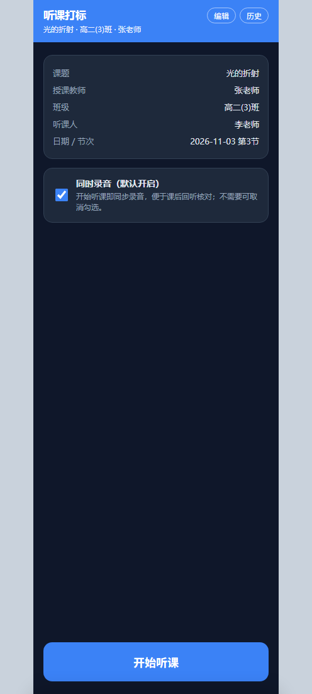
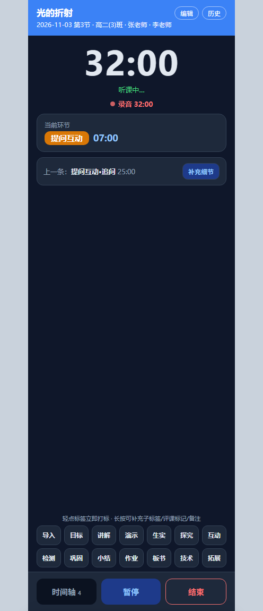
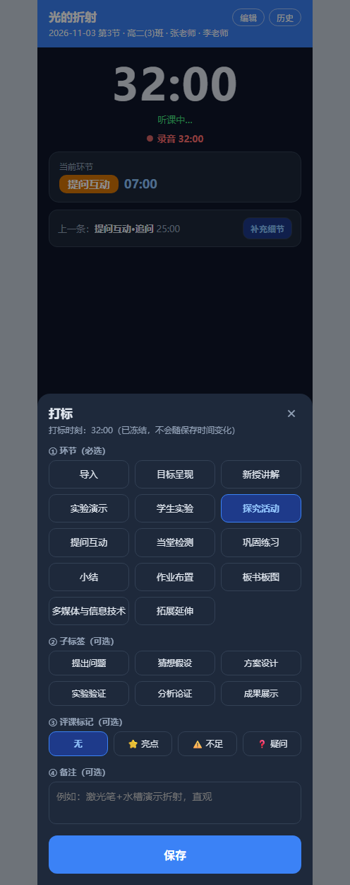
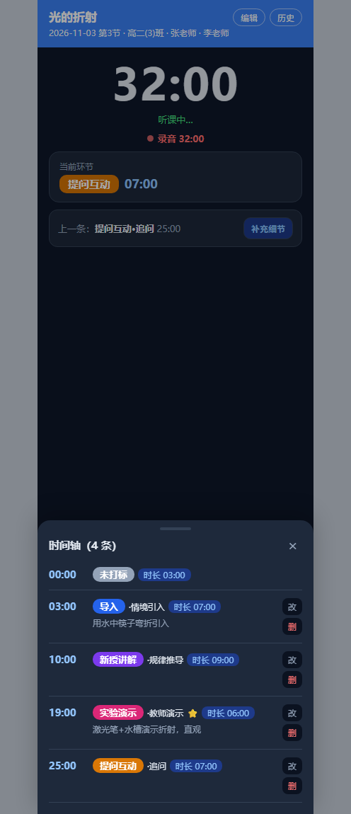
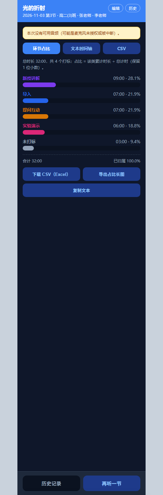
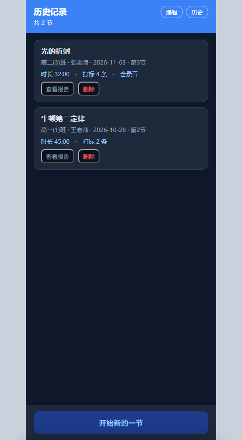

# 听课打标（TingKe）

面向中学**随堂听课 / 评课 / 教研复盘**的安卓 App：**计时 + 一键打标 + 同步录音 + 独立评课标记 + 环节占比**。

给听课人（教研组、备课组、督学）用：上课时轻点标签就能记下「这一刻在干什么」，下课自动生成
时间轴与环节占比，可导出文本 / CSV / 长图发到教研群，也支持回听录音核对课堂原声。

- 平台：Android 8.0+（minSdk 26 / targetSdk 34）
- 技术栈：Kotlin + Jetpack Compose（Material 3）、Room、MediaRecorder、前台服务录音、Canvas 导图
- 界面：**仅手机竖屏**，单 Activity
- 当前版本：**v1.6.1**（versionCode 6）

---

## 功能

### 听课计时与一键打标

- 开始页填听课信息，默认勾选**同时录音**（可取消），点「开始听课」即计时 + 录音
- 14 个课堂环节标签常驻底部标签坞：导入 / 目标呈现 / 新授讲解 / 实验演示 / 学生实验 / 探究活动 /
  提问互动 / 当堂检测 / 巩固练习 / 小结 / 作业布置 / 板书板图 / 多媒体与信息技术 / 拓展延伸
- **轻点**立即落一条打标（顶部提示可 5 秒内撤销）；**长按**打开弹窗补充子标签、备注
- 子标签带预设列表，并支持**「自定义…」自填**
- 计时页实时显示「当前环节」及其已持续时长；「上一条」是当前环节之前那条，可就地修改
- 计时中保持屏幕常亮；返回键有二次确认，不会误退

### 独立评课标记（不进环节统计）

- 亮点 ⭐ / 不足 ⚠️ / 疑问 ❓ 三个按钮：轻点立即记录，长按可加备注
- 它是时间轴上的**点事件**：只记时刻 + 类别 + 备注，**不占用环节时长、不计入环节占比**，
  报告里单独成段列出

### 录音

- 前台服务（`foregroundServiceType="microphone"`）保证**熄屏 / 切后台仍持续录音**（实测熄屏 10 分钟以上正常）
- 分段录制，报告页可逐段回听：进度条可拖动、播完自动复位
- 单段 / 多段分享（`ACTION_SEND` + FileProvider），可直接发微信、存网盘
- 录音只存在 App 私有目录 `files/recordings/`，不上传；删除听课记录会一并删除录音文件

### 报告与导出

- 环节占比（按环节累计时长 ÷ 总计时，保留 1 位小数）+ 未打标段
- 文本时间轴、CSV（带 UTF-8 BOM，Excel 直开不乱码，末尾含学段/科目两列）
- 一键生成「环节占比长图」，可直接发教研群
- 复制文本 / 分享文本

### 历史记录

- 结束即自动存档；冷启动可恢复未结束的计时
- 历史卡片可**修改听课信息**（课题 / 学段 / 科目 / 教师 / 教师单位 / 班级 / 听课人 / 听课人单位 / 日期 / 节次 / 人数 / 地点）
- 删除有二次确认，并**连带删除该节录音文件**

### 听课信息字段

| 字段 | 取值 | 默认 |
|---|---|---|
| 学段 | 初中 / 高中 / 自定义 | 初中 |
| 科目 | 语文、数学、英语、物理、化学、生物、道德与法治、历史、地理、科学、体育与健康、音乐、美术、信息技术、通用技术 / 自定义 | 物理 |
| 授课教师单位、听课人单位 | 自由文本 | 晋江市陈埭民族中学 |

> 学校名与选项表集中在 `app/src/main/java/com/phygroup/tingke/domain/Core.kt` 的 `object Meta`，改一处即可换校名/改科目表。

---

## 截图

| 开始页 | 计时页（一键打标） |
|---|---|
|  |  |

| 打标弹窗（时刻已冻结） | 时间轴 |
|---|---|
|  |  |

| 报告页（环节占比） | 历史记录 |
|---|---|
|  |  |

（截图为 v1.2 交互原型，功能与当前一致；`docs/` 下还有可点按的 HTML 原型）

---

## 构建

需要 **JDK 17** 与 Android SDK（platform android-34、build-tools 34.0.0）。

```bash
git clone <this repo>
cd <repo>
echo "sdk.dir=/path/to/Android/Sdk" > local.properties   # 或直接用 Android Studio 打开
./gradlew assembleDebug                                   # Windows: gradlew.bat assembleDebug
```

产物：`app/build/outputs/apk/debug/app-debug.apk`

用 Android Studio 打开仓库根目录即可（首次 Sync 会下载依赖）。
Gradle 8.7 + AGP 8.5.2 + Kotlin 1.9.24 + Compose BOM 2024.06.00 + Room 2.6.1（KSP）。
wrapper 指向腾讯云镜像，如需官方源改 `gradle/wrapper/gradle-wrapper.properties`。

---

## 目录结构

```
.
├── app/src/main/
│   ├── AndroidManifest.xml          权限 / 屏幕方向 / FileProvider / 录音前台服务
│   ├── java/com/phygroup/tingke/
│   │   ├── MainActivity.kt           单 Activity + Compose，锁竖屏、计时常亮
│   │   ├── audio/                    MediaRecorder 分段录制、前台服务
│   │   ├── data/                     Room 实体/DAO（sessions/marks/audio_segments）、仓库
│   │   ├── domain/Core.kt            标签体系、学段科目选项、统计口径、文本/CSV 生成
│   │   ├── export/Exports.kt         分享文本/CSV/长图/录音
│   │   └── ui/                       开始页、计时页、打标弹窗、时间轴、报告页、历史页
│   └── res/
├── docs/
│   ├── 设计方案.md                   设计说明 + 各版本问题修复台账（含数据库迁移与统计不变量）
│   ├── 变更记录与修复台账.md           v1.2 → v1.6.1 逐版变更
│   ├── 交互原型-v1.2.html            可点按的 HTML 原型
│   └── screenshots/
└── gradle/, gradlew, *.gradle.kts
```

---

## 统计口径

- 环节时长：某条打标的时长 = 下一条**环节**标记的时刻 − 本时刻；末段 = 结束时刻 − 末条时刻
- 未打标：0 → 首个环节标记；若一条环节标记都没有，则整节都算未打标
- 比例：该类累计时长 ÷ 总计时，保留 1 位小数
- 评课标记：点事件，不参与以上任何计算（代码里统一先经 `envMarks()` 过滤）

---

## 版本

| 版本 | 主要内容 |
|---|---|
| v1.2 | 首版落地：计时、一键打标、录音、报告、历史 |
| v1.3 | 熄屏/后台录音（前台服务）、历史打标丢失（`@Upsert` 修复级联删除）、回放进度、提示遮挡、返回键、录音分享 |
| v1.4 | 全竖屏（不支持平板/横屏）；历史记录可修改听课信息 |
| v1.5 | 历史删除二次确认；子标签可自填；工程归档 |
| v1.6 | 「补充细节」归位当前环节、「上一条」可单独修改；**评课标记独立成条且不进环节占比**；删除记录连带删除录音 |
| v1.6.1 | 听课信息增加授课教师单位 / 听课人单位 / 学段 / 科目；Room 升到 version 2（显式迁移，历史记录不丢） |

详细修复过程与「不得破坏的不变量」见 `docs/设计方案.md` 第十三节。
